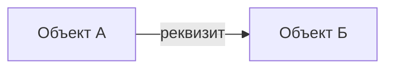

# Спецификация {КЛЮЧ}: {Краткое наименование}

- **Задача:** [{КЛЮЧ}]({URL_ТИКЕТА})
- **Статус:** `draft`
- **Дата составления:** {ГГГГ-ММ-ДД}
- **Журнал работы:** `worklog/{КЛЮЧ}.md`

<!--
Как заполнять:
- Спецификация - единственный источник правды по задаче. Код меняется после спецификации, не наоборот.
- Разделы 1-5 отвечают на вопрос «что и зачем» и не содержат имен модулей и метаданных.
- Разделы 6-8 отвечают на вопрос «как» и опираются на правила из rules/.
- Все непонятное помечается [УТОЧНИТЬ: вопрос] прямо в тексте и дублируется в разделе 5.
- Спецификация - локальный рабочий документ и в репозиторий не коммитится.
- Идентификаторы (ТР-, НТ-, П-, Т-, З-) не переиспользуются: удаленный пункт зачеркивается, а не перенумеровывается.
- Подсказки в HTML-комментариях удаляются при заполнении. Пустой раздел не удаляется, в нем пишется «Нет».
-->

## Ворота согласования

| Этап | Условие перехода | Согласовано |
|---|---|---|
| Требования | Разделы 1-5 заполнены, в разделе 5 нет открытых критических замечаний и вопросов, влияющих на требования | [ ] {ГГГГ-ММ-ДД} |
| Описание реализации | Разделы 6-8 заполнены, чек-лист раздела 8 пройден | [ ] {ГГГГ-ММ-ДД} |
| Задачи | Каждое требование покрыто задачей, критерием приемки и, где применимо, unit-тестом (раздел 12) | [ ] {ГГГГ-ММ-ДД} |
| Приемка | Все критерии раздела 3 выполнены, unit-тесты раздела 10 проходят, диагностика без новых замечаний | [ ] {ГГГГ-ММ-ДД} |

Статус (в шапке и во frontmatter): `draft` - пишутся требования, `approved` - требования и описание реализации согласованы, `implementing` - идет реализация, `done` - приемка пройдена, `rejected` - задача снята.

## 1. Контекст и цель

<!-- Какую проблему решаем, для кого и как поймем, что решили. Без описания реализации. -->

- **Проблема:** {Что сейчас не так или чего не хватает}
- **Пользователи:** {Роли пользователей, которых касается доработка}
- **Цель:** {Какой результат получает пользователь или бизнес}
- **Связанные задачи и документы:** {Ключи задач, ADR, разделы docs/}

## 2. Требования

### 2.1. Функциональные требования

<!--
Одно требование - одно проверяемое поведение системы. Формулировка «Система должна...» или «Пользователь может...».
Приоритет: Обязательно / Желательно / Можно позже.
-->

| ИД | Требование | Приоритет |
|---|---|---|
| ТР-1 | {Пользователь может ...} | Обязательно |
| ТР-2 | {Система не дает записать ..., если ...} | Обязательно |

### 2.2. Нефункциональные требования

<!-- Только то, что реально важно для этой задачи. Лишние строки удалить. -->

| ИД | Область | Требование |
|---|---|---|
| НТ-1 | Права доступа | {Кто читает, кто изменяет, есть ли ограничение на уровне записей} |
| НТ-2 | Производительность | {Объем данных, допустимое время открытия формы или проведения} |
| НТ-3 | Совместимость и обновление | {Типовой код, расширения, обработчики обновления, перенос существующих данных} |
| НТ-4 | Интерфейс | {Где команда в командном интерфейсе, клиенты: тонкий, веб, мобильный} |

## 3. Критерии приемки

<!--
Каждое требование ТР- покрыто хотя бы одним критерием. Обязательно есть негативные критерии.
Формат совместим с Vanessa Automation, чтобы позже перенести сценарии в .feature без переписывания.
-->

### П-1. {Название критерия} (ТР-1)

- **Дано** {начальное состояние данных}
- **Когда** {действие пользователя}
- **Тогда** {наблюдаемый результат}

### П-2. {Негативный критерий} (ТР-2)

- **Дано** {...}
- **Когда** {...}
- **Тогда** {система сообщает ... и не записывает объект}

## 4. Границы

<!-- Что сознательно не входит в эту поставку. Это защита от разрастания задачи во время реализации. -->

Не делаем:

- {...}

Откладываем на следующие поставки:

- {...}

## 5. Критические замечания, открытые вопросы

<!--
Критическое замечание - найденная проблема, которая ломает требования или реализацию: противоречие, риск потери данных, нарушение прав, невыполнимое ограничение.
Открытый вопрос - то, что нельзя решить без пользователя или аналитика.
Пункт закрывается ответом и датой, затем решение переносится в раздел 6, а пометка [УТОЧНИТЬ] в тексте убирается.
Пока есть открытый пункт с влиянием «требования», ворота «Требования» не проходятся.
-->

| № | Вид | Суть | Влияет на | Решение | Дата |
|---|---|---|---|---|---|
| 1 | замечание / вопрос | {...} | требования / реализация / задачи | | |

## 6. Принятые решения

<!-- Решение и почему. Принципиальные архитектурные решения выносятся в ADR (Architecture/{КЛЮЧ}-{слаг}.md), здесь ссылка. -->

- {Решение}. Причина: {почему так, а не иначе}.

## 7. Описание реализации

### 7.1. Зона кода и размещение

<!-- По rules/project-context.md и project-profile.md ({NEW_OBJECTS_IN}, {PREFIX}). -->

- **Зона:** {проектный код / типовой код с минимальной правкой / расширение}
- **Размещение:** {каталог исходников по {EDT_PROJECT_FORMAT} или расширение}
- **Подсистема:** {...}

### 7.2. Изменения метаданных

| Объект | Действие | Что меняется | Требования |
|---|---|---|---|
| `{Справочник.Имя}` | создать | {Реквизиты, табличные части, формы} | ТР-1 |
| `{Перечисление.Имя}` | создать | {Значения} | ТР-1 |
| `{ОбщийМодуль.Имя}` | изменить | {Новые экспортные методы} | ТР-2 |

### 7.3. Модель данных

<!-- Таблицы реквизитов и схема связей. Для каждого реквизита: тип, обязательность, значение по умолчанию, назначение. -->

| Объект | Реквизит | Тип | Заполнение | Назначение |
|---|---|---|---|---|
| `{...}` | `{...}` | `{...}` | обязательно / по умолчанию ... | {...} |

### 7.4. Логика

<!--
Где живет каждое правило: модуль объекта, модуль менеджера, общий модуль, модуль формы.
Для каждого метода: контекст (сервер, клиент, клиент-сервер), вход, выход, что проверяет.
Запросы описываются словами и схемой временных таблиц, без полного текста.
-->

| Модуль | Метод / событие | Контекст | Что делает | Требования |
|---|---|---|---|---|
| `{МодульОбъекта Справочник.Имя}` | `ОбработкаПроверкиЗаполнения` | сервер | {...} | ТР-2 |

### 7.5. Формы

<!-- Состав формы по rules/forms.md: группы, закладки, что только для просмотра, команды, когда пересчитывается. -->

- {...}

### 7.6. Права доступа

<!-- Роли, профили групп доступа, ограничения на уровне записей, место регистрации в УправлениеДоступомПереопределяемый. -->

- {...}

### 7.7. Транзакции и блокировки

<!-- По rules/locks-and-transactions.md. Если запись в регистры и транзакции не затрагиваются, написать «Не затрагиваются». -->

- {...}

### 7.8. Обновление и перенос данных

<!-- Обработчики обновления, заполнение новых реквизитов в существующих данных. Если не нужно, написать «Не требуется». -->

- {...}

### 7.9. Риски

| Риск | Последствие | Как снижаем |
|---|---|---|
| {...} | {...} | {...} |

## 8. Проверка реализации по правилам

<!-- Отметить каждый пункт. Неприменимый пункт отмечается с пометкой «н/п». -->

- [ ] Зона кода определена, типовой и сторонний код меняется минимально или не меняется (`rules/project-context.md`).
- [ ] Имена объектов и реквизитов соответствуют `rules/metadata-naming.md` и `{PREFIX}`.
- [ ] Вызовы БСП проверены по справочнику `skills/bsp-api/SKILL.md`, чтение реквизитов ссылок через `ОбщегоНазначения.ЗначениеРеквизитаОбъекта*`.
- [ ] Нет запросов в цикле, запросы спроектированы по `rules/query-design.md`.
- [ ] Блокировки и транзакции соответствуют `{LOCK_MODE}` и `rules/locks-and-transactions.md`.
- [ ] Клиентский код учитывает `{PLATFORM_VERSION}` и `rules/async-methods.md`.
- [ ] Структура модулей соответствует `rules/module-structure.md`.
- [ ] Правила с пометкой «строже стандарта ИТС» не ослаблены.

## 9. Задачи реализации

<!--
Задачи в порядке выполнения. Одна задача - один проверяемый результат, который можно закоммитить.
Задача отмечается выполненной только после проверки по ее условию готовности.
-->

- [ ] **З-1.** {Создать перечисления ...}
  - Покрывает: ТР-1
  - Файлы: `{путь к исходникам перечисления}`
  - Готово, когда: {объект зарегистрирован в конфигурации, UUID без дублей}
- [ ] **З-2.** {...}
  - Покрывает: ТР-2
  - Файлы: `{...}`
  - Готово, когда: {...}

## 10. Покрытие unit-тестами

<!--
Тесты пишутся по skills/yaxunit-tests/SKILL.md и rules/project-context.md (раздел «Тесты на YAxUnit»).
Покрываются экспортные методы с логикой: расчеты, проверки, преобразования данных. Формы и чистый интерфейс покрываются критериями приемки.
Если {TEST_FRAMEWORKS} = Отсутствуют, таблица все равно заполняется: это список тестов, которые нужно написать при подключении YAxUnit, а в колонке «Статус» ставится «не написан».
-->

- **Тестовый модуль:** `{ОбщийМодуль.ОМ_Имя}`
- **Фабрика тестовых данных:** {Как создаются данные для тестов}

| ИД | Метод | Тест | Что проверяет | Требования | Статус |
|---|---|---|---|---|---|
| Т-1 | `{Модуль.Метод}` | `{ИмяТеста}` | {Обычный случай: ...} | ТР-1 | не написан / проходит / падает |
| Т-2 | `{Модуль.Метод}` | `{ИмяТеста}` | {Граничный случай: пустые данные, ...} | ТР-2 | |

Не покрывается unit-тестами и почему:

- {...}

## 11. Проверка

<!-- Чем подтверждается приемка, кроме unit-тестов. -->

- **Критерии приемки:** П-1 ... П-N проверяются в клиенте {вручную / Vanessa Automation}.
- **Диагностика:** BSL Language Server по измененным модулям без новых замечаний (`skills/bsl-diagnostics/SKILL.md`).
- **Метаданные:** UUID новых объектов проверены `skills/edt-metadata/scripts/check_uuid_duplicates.py`.
- **Тестовые данные:** {Какие данные нужны в базе для проверки критериев}

## 12. Трассировка

<!-- Заполняется при прохождении ворот «Задачи». Требование без критерия приемки или без задачи - повод вернуться к разделам 3 и 9. -->

| Требование | Критерии приемки | Unit-тесты | Задачи | Результат приемки |
|---|---|---|---|---|
| ТР-1 | П-1 | Т-1 | З-1 | |
| ТР-2 | П-2 | Т-2 | З-2 | |

## 13. Изменения после согласования

<!--
Любое изменение требований или проекта после согласования сначала вносится в спецификацию, потом в код.
Если изменение затрагивает требования, ворота «Требования» проходятся заново.
-->

| Дата | Раздел | Что изменилось | Причина |
|---|---|---|---|
| | | | |
